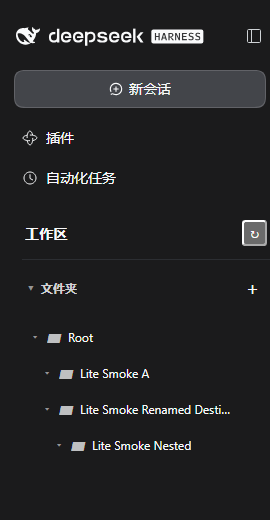

# Workspace Organizer for DSH

**Lite Preview · v0.1.2-ui.1** — 用文件夹整理 DeepSeek Harness 会话的轻量插件。

> [!WARNING]
> **这是预览版，不是完整 v1.0。** 文件夹功能已在隔离 DSH 中实测；“关联并打开真实已有会话”目前仅通过模拟宿主测试，尚未完成真实会话的端到端验收。请先在独立 `DSH_HOME` 中试用，不建议直接部署到日常数据环境。



## 可以做什么

- 创建、嵌套、展开、重命名和移动文件夹；组织树在 DSH 重启后恢复。
- 在文件夹中**逻辑关联**已有 DSH Session，并允许调整其文件夹归属。关联不搬迁聊天记录、会话文件或工作目录（`cwd`）。
- 侧边栏 Lite UI：文件夹树作为主要界面，行操作收在 `···` 菜单，优先保证日常阅读和操作的清晰度。
- 尝试通过宿主的 `sessionQuery.readSession` 验证已有会话，并通过 `uiWorkspace.openSession` 打开；接口不支持或校验失败时，明确返回错误。

**当前限制：** 宿主未提供经确认的已有会话枚举/选择入口，因此目前需要手动填写 Session ID。不存在或不可读的 ID 会被拒绝。原生会话打开流程尚待真实宿主实证。拖拽、搜索、多窗口、Memory、Instructions、权限继承和 Task Center 深度功能**不属于 Lite 预览版**。

## 安装：隔离 Profile（推荐）

要求：Node.js 24+、DeepSeek Harness **0.2.1-rc.2** 及可用的 `dsh` 命令。Windows 上经过隔离宿主测试；其他平台未验证。

从 [Releases](https://github.com/ShakeCrane/Workspace-Organizer-dsh/releases) 下载 `workspace-organizer-dsh-0.1.2-ui.1.tgz`，然后在 PowerShell 中：

```powershell
$env:DSH_HOME = 'C:\DSH-Lite-Isolated'
dsh --profile organizer-lite --from-default-profile web --dump-config
dsh plugin --profile organizer-lite add 'file:C:\path\workspace-organizer-dsh-0.1.2-ui.1.tgz'
dsh --profile organizer-lite
```

打开侧栏的 **工作区 / 文件夹**：点击 `＋` 创建文件夹；通过文件夹行 `···` 进行重命名、新建子文件夹或关联已有会话；选中节点后可使用移动面板切换位置。

**pnpm 安装包方式：** 该 `.tgz` 是标准包归档，也可以通过 `pnpm add <tgz 本地路径或 GitHub Release 资产 URL>` 安装到独立的 Node 项目。**单独运行 `pnpm add` 不等于将插件激活到 DSH Profile**，实际 DSH 安装仍应走上面的插件管理命令。npm registry 的 `@preview` dist-tag 只有在完成认证并实际发布后才可用，不应提前使用 `pnpm add workspace-organizer-dsh@preview`。

### 卸载与数据安全

```powershell
dsh plugin --profile organizer-lite remove workspace-organizer-dsh
```

此操作不会主动迁移或删除原始 DSH 会话；插件的目录数据单独保存在 `DSH_HOME/workspace-organizer/`。**卸载插件前请备份该目录**，避免之后误删。回滚时移除当前版本并安装先前自行保存的 `.tgz`；不用插件时原生侧边栏可恢复。

## 开发与构建

```bash
pnpm install --frozen-lockfile
pnpm run typecheck
pnpm test
pnpm run pack:plugin
```

`pack:plugin` 先编译 TypeScript，再将 `dist/`、客户端、清单和运行所需文件暂存打包，最后核验包内 `dist/index.js` 等必需文件。生成的文件位于 `test/lite-release-packages/`（被 Git 忽略）。

当前公共代码快照移除了旧版 C3a 响应观测器和对应过期测试；Lite 预览范围测试 **585/585 通过**。隔离 DSH + Edge 浏览器测试完成文件夹创建、嵌套、移动、重命名和重启恢复；未完成真实已有会话的正向打开演示。完整验证范围与证据说明见 [开发与验证](docs/DEVELOPMENT.md)。

## 文档与版本约定

- [预览版发布说明](docs/RELEASE_NOTES_v0.1.2-ui.1.md)：功能、限制和验证状态。
- [开发与验证](docs/DEVELOPMENT.md)：仓库边界、构建、测试、发布流程。
- [变更日志](CHANGELOG.md)：各版本用户可见变化。

仓库根目录只保留能够理解、构建和测试此预览版所需的源码与维护文件。长期设计规范、内部 Agent 派工资料、历史 ZIP 和原始审计证据仍保存在开发工作区，**不包含在公开发行快照或 npm 包中**。

[MIT License](LICENSE) · 此项目为独立社区插件，不代表 DeepSeek Harness 官方发布。
